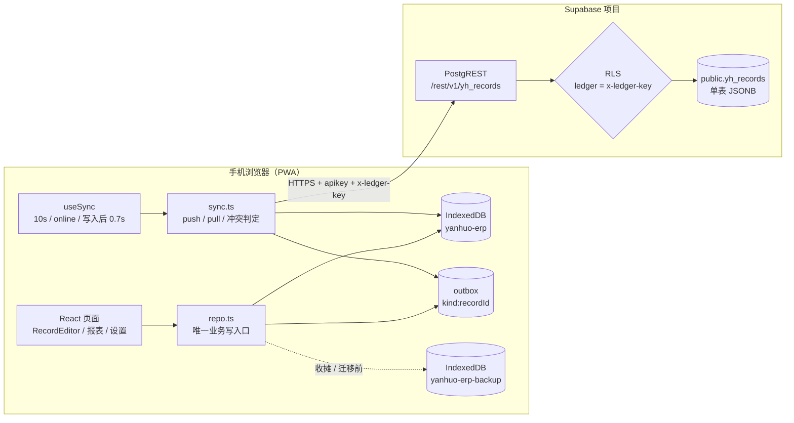

# 架构概览

> 一句话：单页 PWA 本地优先；IndexedDB 是真相，outbox 负责补发，Supabase 单表 JSONB 是云端副本。

## 数据流（10 行以内）

1. 用户在页面记一笔，调用 `repo.saveRecord`。
2. 事务内写 `orders` + `lines`，并自动挂到本机 open 场次。
3. 同时向 `outbox` 登记 `order:<id>` 与每条 `line:<id>`。
4. `useSync` 在写入后 0.7s、每 10s、联网/回到前台时触发。
5. `sync.ts` 每批最多 push 300 条到 `yh_records`，`updated_at` 作增量水位。
6. 云端 RLS 校验 `x-ledger-key` 与行上 `ledger` 相等。
7. 拉取按 `updated_at > 本地水位` 分页（每页 500 条，最多 20 页）。
8. 每条远端记录按业务时间 `record_updated_at` / `data.updatedAt` 判定 take-remote / keep-local / conflict。
9. 冲突写入本地 `conflicts` 表，本地记录保留，设置页显示「待核对」。
10. 收摊/升级前把整库导出到独立备份库，恢复时整库替换并默认暂停云同步。