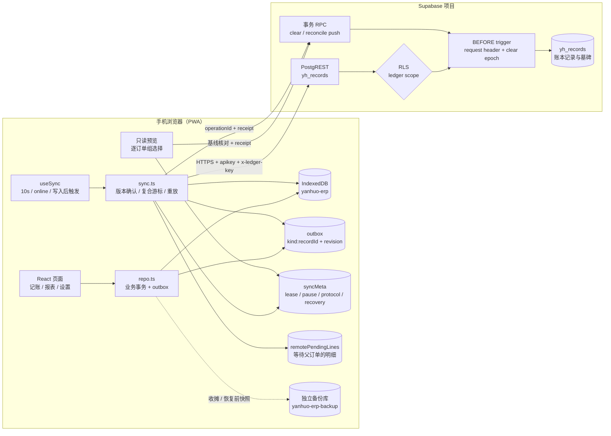

# 架构概览

> 一句话：单页 PWA 本地优先；IndexedDB 是业务真相与恢复控制面，带 revision 的 outbox 补发，Supabase `yh_records` 是账本隔离的云端副本。

## 数据流（核心路径）

1. `repo.saveRecord` 在同一个 IndexedDB 事务内写 `orders` / `lines`、本机场次及 outbox；同记录每次入队生成新 `revision`，避免旧请求 ACK 清掉后续编辑。
2. `useSync` 在写入后、定时、联网或回到前台触发；同步租约、generation、fence、暂停与维护互斥状态持久化在 `syncMeta`。
3. push 每批最多 300 条；HTTP 在 IDB 事务外等待，回执只确认发送过的 revision。入站按 schema 校验，待推送本机行不被远端覆盖。
4. 拉取以 `(updated_at, id)` 复合游标分页（每页 500 条、每轮最多 20 页），首个增量请求用 5 分钟重叠窗口；每日全量重放带持久续扫游标，未完成会保留未完成状态。
5. 尚未读到父订单的远端明细暂存于 `remotePendingLines`，不进入库存/报表；父单到达并完成校验后再应用。业务版本按 `record_updated_at` / 数据业务时间比较，规范化内容比较避免假冲突。
6. 真正的远端覆盖、删除和复活记入本地提示与可撤销快照；冲突按 `(kind, recordId)` 合并留痕，不把本地待推内容当作远端胜出。
7. 恢复快照或撤销合并只替换本机：先独立备份，原子替换业务表并清 outbox、conflicts、待决明细、撤销快照，保留设备身份并持久暂停同步。
8. 重连先生成只读、逐订单组预览。确认前持久保存远端基线、操作号与不可变请求；`yh_reconcile_push` 在同账本锁内比较基线并上传，receipt 确认后才按匹配 revision 清理队列。
9. 清云只调用幂等 `yh_clear_ledger` 事务 RPC；客户端以同一 `operationId` 跟踪 `pending` / `unknown` / `confirmed`。服务端原子写墓碑、clear epoch、标记和 receipt；取得有效 receipt 后才清本机并原子记录完成状态，不回退到 PATCH + POST 两请求路径。
10. PostgREST RLS 按 ledger 限定行范围；`BEFORE INSERT/UPDATE` trigger 校验请求 epoch header 与数据库当前 `clear_epoch` 一致。清云 RPC 在事务内推进 epoch 并设置本次头值，条件重连 RPC 仍经过同一 trigger 校验；definer 函数自身另做 ledger 作用域检查。独立 loopback PostgREST/多连接验收是本轮有效测试证据；它不代表生产迁移、生产云端或目标真机结果。